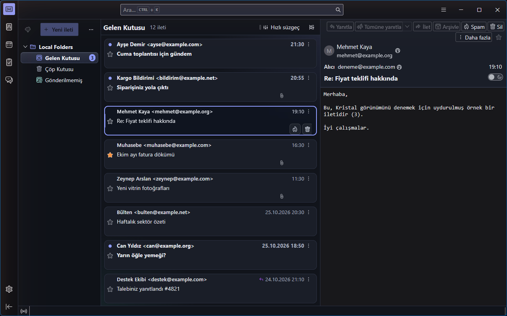
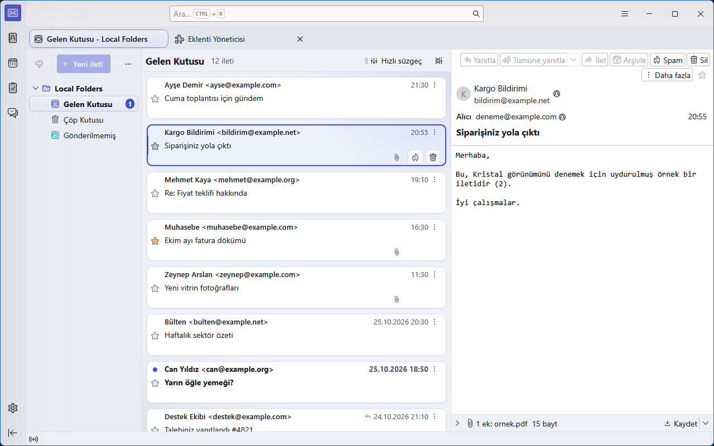

# Kristal — Thunderbird görünümü

Okumayı, ileti seçmeyi ve silmeyi kolaylaştıran sade, erişilebilir bir
Thunderbird görünümü.

- Seçtiğiniz ileti kartının arka planı tamamen şeffaf olur; arkasındaki
  listenin hafif ışığı görünür. Seçim; vurgu renginde çerçeve, parlak üst
  kenar ve solda ince bir vurgu çubuğuyla belli olur. Firefox'taki seçili
  sekme etkisine benzer.
- Her kartın sağ altında yan yana **Spam** ve **Sil** düğmeleri vardır.
  Seçili kartta ve fareyle üzerine gelince görünürler (ayarlardan "her
  zaman" da yapılabilir).
- **Okunmamış iletiler** hafif renkli, daha parlak zeminli ve solda vurgu
  çizgilidir; okunmuşlar sönük zeminlidir. Kart ve liste görünümünde aynı.
- **Yıldız** kartın başındadır: okunmamış noktasının altında, konu satırının
  hizasında.
- Seçili sekme de aynı cam görünümündedir.
- Koyu ve açık mod Windows ayarını kendiliğinden izler.

Denenen sürümler: **Thunderbird 158.0.1 ve 161.0, Windows 11**, kart görünümü.
Başka sürümlerde denenmedi.





Görüntüler uydurma örnek postalarla çekildi.

## Bu neden "tema" değil de "eklenti"?

Thunderbird'ün resmî tema biçimi yalnızca renk ve arka plan resmi
değiştirebilir. Karta düğme eklemek ve cam efekti vermek bunun dışında
kalıyor. Bu yüzden Kristal bir **eklenti** olarak yapıldı.

Kurarken Thunderbird, eklentinin "Thunderbird'e ve bilgisayarınıza tam,
kısıtlamasız erişim" istediğini söyler. Bunun sebebi şu: Kristal,
Thunderbird'ün kendi pencerelerine stil dosyası yükleyip kartlara düğme
ekliyor ve bu ancak "deneysel API" (Experiment; eklentinin Thunderbird'ün iç
yapısına erişmesine izin veren bölüm) ile yapılabiliyor. Kristal ağa
bağlanmaz, postalarınızı okumaz, hiçbir yere veri göndermez. Kodun
tamamı `src` klasöründedir.

## Kurulum

1. En yeni sürüm **1.0.11**:
   [`kristal-1.0.11.xpi`](https://github.com/borasavkar/kristal-thunderbird/releases/download/v1.0.11/kristal-1.0.11.xpi)
   dosyasını indirin. Daha yeni bir sürüm çıktıysa
   [Sürümler sayfasında](https://github.com/borasavkar/kristal-thunderbird/releases/latest)
   bulunur.
2. Thunderbird'de sağ üstteki **☰** menüsünden **Eklentiler ve temalar**'ı açın.
3. **Uzantılar** sayfasında dişli (⚙) simgesine, sonra **Dosyadan eklenti yükle…**'ye tıklayın.
4. İndirdiğiniz dosyayı seçin ve **Ekle** deyin.

1.0.8 ve sonrası kendini GitHub'dan günceller: yeni sürüm çıkınca Thunderbird
onu kendiliğinden bulur ve kurar. 1.0.7 veya daha eskisini kurduysanız 1.0.11'i
yukarıdaki adımlarla bir kez elle kurmanız yeterli; sonrası kendiliğinden gelir.

1.0.11'den beri Kristal'de üst Thunderbird sürüm sınırı yok: Thunderbird
güncellenince Kristal "uyumsuz" diye kapanmaz. Bir Thunderbird güncellemesinden
sonra düğmeler ya da görünüm bozulursa lütfen bir
[sorun bildirin](https://github.com/borasavkar/kristal-thunderbird/issues).

Kristal, Thunderbird'ün resmî eklenti sitesinde yok (aşağıya bakın); bu yüzden
yalnızca buradan dağıtılıyor.

Yalnızca renklerden oluşan **Kristal Colors** teması ise Mozilla'da yayında:
[addons.thunderbird.net/thunderbird/addon/kristal-colors](https://addons.thunderbird.net/thunderbird/addon/kristal-colors/).
Kaynağı `theme/` klasöründe. Tema yalnızca renkleri değiştirir; Spam ve Sil
düğmeleri, cam kart ve efektler bu eklentiden gelir.

En iyi sonuç için:

- **Eklentiler ve temalar → Temalar** bölümünde Thunderbird'ün varsayılan
  sistem teması (otomatik) etkin olsun. Başka bir tema seçiliyse bazı
  renkler o temadan gelebilir.
- Posta listesi **kart görünümünde** olsun (Thunderbird'ün varsayılanı budur;
  liste başlığının sağındaki görünüm düğmesinden değiştirilir). Tablo
  görünümünde Thunderbird'ün kendi "Sil" sütunu kullanılabilir (sütun
  seçiciden açılır).

## Ayarlar

**Eklentiler ve temalar → Kristal → anahtar (🔧) simgesi**. Değişiklikler hemen
uygulanır.

- **Vurgu rengi:** Çivit (varsayılan), Zümrüt, Gül, Kehribar, Grafit.
- **Karttaki Spam ve Sil düğmeleri:** seçili kartta ve fareyle üzerine gelince / her zaman.
- **Cam efekti ve arka plan ışığı:** açık / kapalı (kapalıyken düz renk).
- **Kartlar arasında rahat boşluk:** açık / kapalı.

## Düğmeler nasıl çalışıyor?

Düğmeye basınca önce kartta kısa bir efekt oynar (silinen kart kırmızılaşıp
sola kayarak kaybolur, spam işaretlenen kart turuncu yanıp söner), işlem
ondan sonra yapılır ve listenin altında "İleti silindi" gibi bir bilgi
belirir. Arka arkaya birkaç ileti silinirse bilgide sayı da görünür. Efekt ve
ardından gelen kısa süre boyunca Spam/Sil düğmelerine yapılan yeni
tıklamalar yok sayılır; böylece liste kayınca alttaki iletiye yanlışlıkla
basılmaz. "Animasyonları azalt" açıksa kart kaymaz, yalnızca renk alır.

Kristal kendi başına ileti silmez ya da işaretlemez; düğmeler Thunderbird'ün
kendi komutlarını çağırır (tablo görünümündeki Sil ve Spam sütunlarıyla
aynı). Seçili olmayan bir kartın düğmesine basarsanız yalnızca o kart
etkilenir; açık olan iletiniz değişmez. Simgeler de Thunderbird'ün kendi
simgeleridir.

- **Sil:** İleti, hesabınızın ayarına göre Çöp kutusuna taşınır. Klavyede
  **Delete** tuşu aynı işi yapar.
- **Spam:** İleti spam olarak işaretlenir (klavyede **J**). Spam işaretli
  iletide düğme kırmızı görünür; basınca işaret kalkar (klavyede
  **Shift+J**). Thunderbird'ün varsayılan ayarında ileti yalnızca
  işaretlenir, bulunduğu klasörde kalır. Spam klasörüne taşınmasını
  isterseniz Thunderbird'ün **Ayarlar → Gizlilik ve Güvenlik** bölümündeki
  spam (gereksiz ileti) ayarından açabilirsiniz.
- **Yıldız:** Tıklayınca iletiye yıldız konur ya da kaldırılır. Thunderbird,
  spam işaretli iletide yıldızı gizler.

## Erişilebilirlik

- Yazı renkleri WCAG 2.2 AA'ya göre hesaplandı: normal yazı en az 4.5:1,
  simge ve çerçeveler en az 3:1. Seçili cam kartta bile, arka plan ışığının
  en güçlü olduğu durum hesaba katıldı.
- Seçim yalnızca renkle değil, çerçeve ve sol vurgu çubuğuyla da gösterilir.
- Klavye odağı 2 piksellik çerçeveyle görünür.
- Spam ve Sil düğmelerinin tıklama alanı 28×28, yıldızınki 24×24 pikseldir
  (WCAG 2.5.8 en az 24×24 ister).
- Windows'ta **Kontrast teması** açıksa Kristal hiçbir rengi değiştirmez;
  Thunderbird'ün erişilebilir sistem renkleri kalır.
- **Animasyonları azalt** açıksa geçiş efektleri kapanır; **Saydamlık
  efektleri** kapalıysa cam yerine düz renk kullanılır.

## Kaldırma

**Eklentiler ve temalar → Uzantılar → Kristal → ••• → Kaldır** (ya da yalnızca
anahtarı kapatın). Kapatınca bütün değişiklikler anında geri alınır.

## Geliştirme

```
python build.py
```

`dist\kristal-<sürüm>.xpi` dosyasını üretir.

Denemek için gerçek profile dokunmadan ayrı bir test profili:

```
python tools/make_test_profile.py <boş-klasör> dist/kristal-<sürüm>.xpi
```

`tools/capture_window.ps1` test penceresini 1280×800 yapıp PNG görüntüsünü alır.

Dosyalar:

| Dosya | Görevi |
|---|---|
| `src/manifest.json` | Eklenti tanımı |
| `src/experiment/implementation.js` | Stil dosyalarını yükler, kartlara Spam ve Sil düğmelerini ekler, yıldızı kartın başına taşır, kart aralığını ayarlar |
| `src/skin/tokens.css` | Renk paleti ve Thunderbird renk değişkenlerinin bağlanması |
| `src/skin/three-pane.css` | Kartlar, cam efekti, Spam/Sil düğmeleri, yıldız, klasör listesi |
| `src/common.js` | Varsayılan ayarlar; ayarları arka plan betiğine ve ayarlar sayfasına ortak olarak verir |
| `src/_locales/` | Düğme ipuçları, ayarlar sayfası ve eklenti açıklamasının Türkçe ve İngilizce yazıları |
| `src/skin/main-window.css` | Sekmeler ve araç çubukları |
| `src/skin/message.css` | İleti başlığı |
| `src/options/` | Ayarlar sayfası |

## Neden Mozilla'nın sitesinde değil?

Kristal 1.0.7, Kasım 2026'da addons.thunderbird.net'te reddedildi. Gerekçe:
"kristal API'si yayımlanmış bir Thunderbird API taslağı değil; deneysel
(Experiment) API'ler kabul edilmiyor." Kristal'in düğmeleri, cam kartı ve
okunmamış vurgusu bu deneysel API ile çalışıyor; Thunderbird'ün resmî
API'lerinde bunların karşılığı yok. Bu yüzden eklenti GitHub'dan dağıtılıyor.

Eski gönderim notları: [docs/ATN-gonderim.md](docs/ATN-gonderim.md)

## Yeni sürüm yayımlama

1. `src/manifest.json` içindeki sürümü yükseltin.
2. `python build.py` ve `python tools/make_updates_json.py` çalıştırın.
3. GitHub'da `v<sürüm>` etiketiyle bir sürüm açıp `dist/kristal-<sürüm>.xpi`
   dosyasını ekleyin; `updates.json`'ı commit edip gönderin.

## Lisans

Kristal, [Mozilla Public License 2.0](LICENSE) ile yayınlanır.
© 2026 Bora Şavkar
